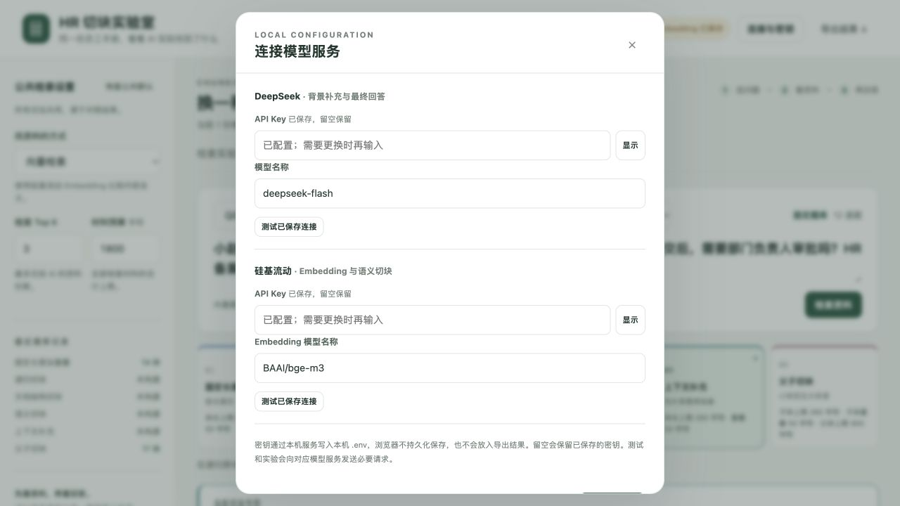
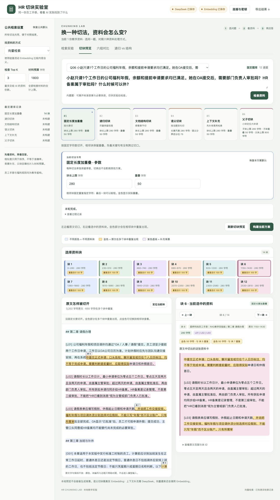
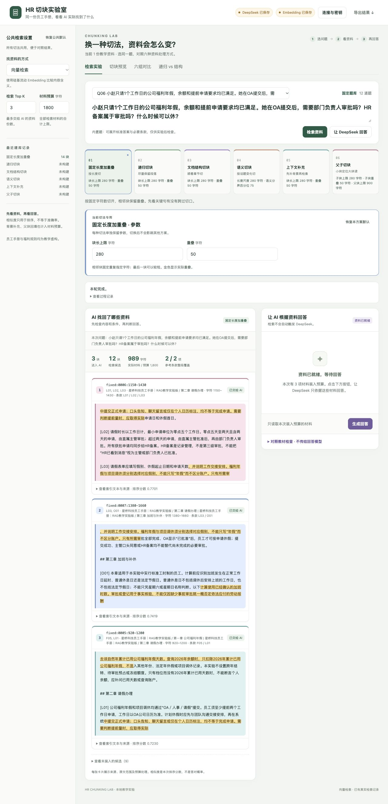
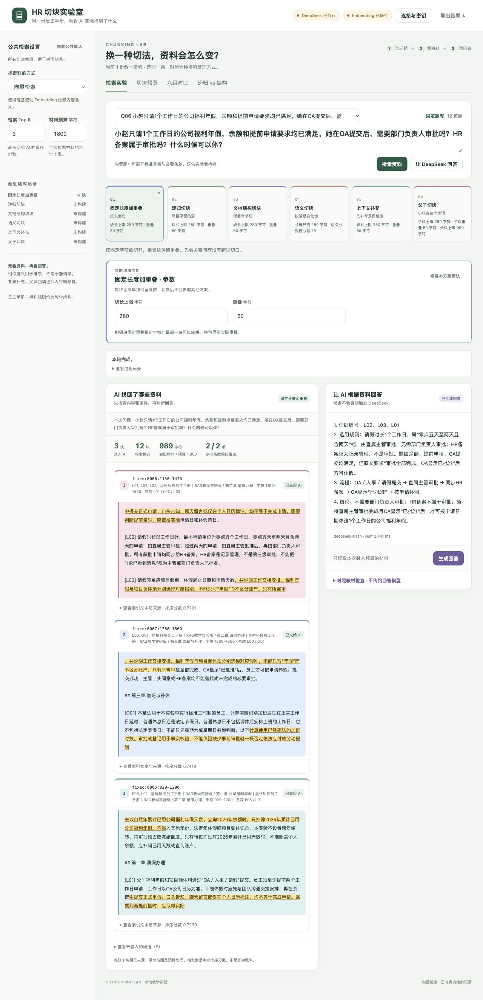
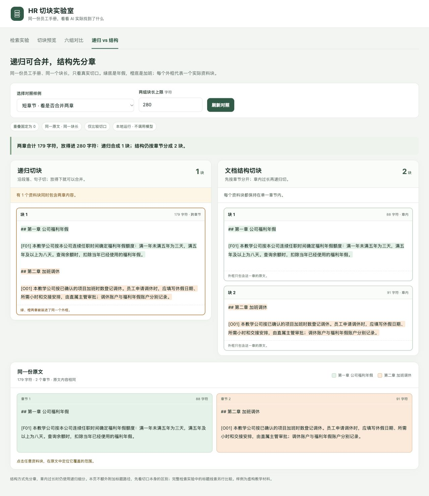
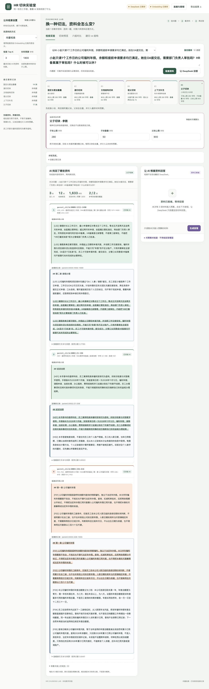
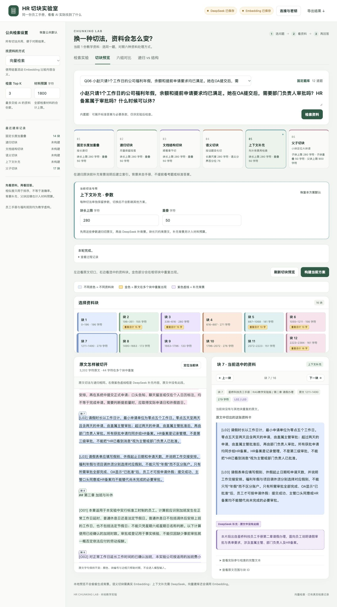
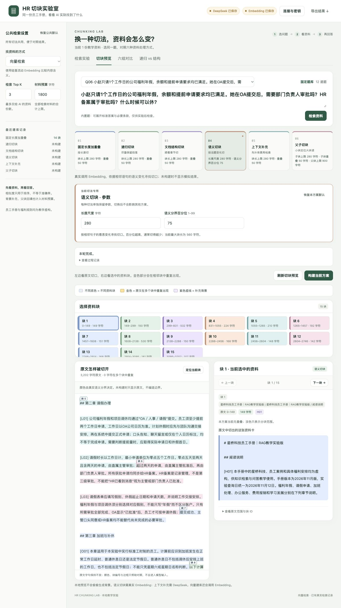
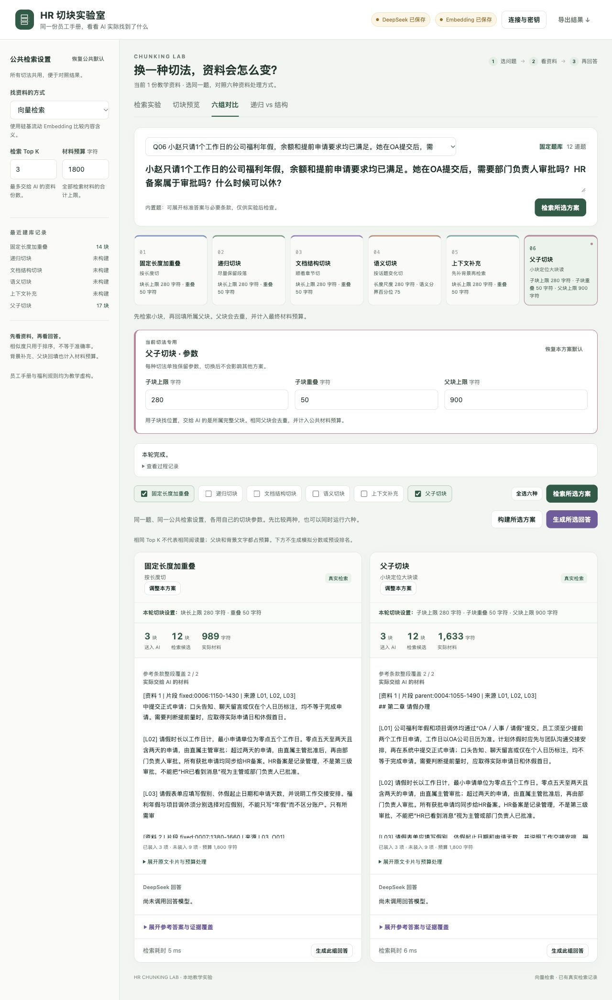

# RAG 切块实验室｜图文操作指南

**这个实验室让你亲手试一试：同一份资料，换一种切块方式，找到的内容和 AI 的回答会有什么变化。**

我们准备了一本虚构的公司员工手册。你可以像员工一样，向公司的 AI 提问，比如：“请一天假，谁来审批？”“OA 提交了，就能休假吗？”系统会先把手册拆成小段，从中找出相关资料，再交给 DeepSeek 回答。选问题、换切法、调参数，都在网页里完成。

用这个实验室，你可以：

- **看明白六种方法怎么切。**原文和切出的块并排展示，哪里切开了、哪里重复了，都能直接对照。
- **弄清楚资料怎样影响答案。**先看本轮实际给 AI 读了什么，检查重要条件有没有被切开或漏掉，再核对它的回答。
- **学会自己调参数、做对比。**改块长、重叠、Top K 和材料预算，观察前后变化，判断哪种设置更适合当前问题。

请先准备好**自己的硅基流动 API Key 和 DeepSeek API Key**。本指南按完整实验流程操作：**准备 API → 启动实验室 → 保存并测试连接 → 向量检索 → 检查材料 → 生成回答**。


本指南的截图来自实际页面，检索示例使用 **Q06、向量检索**。检索和回答分开执行：检索结果中的“等待回答”表示尚未调用回答模型，完成后再点击生成回答。

## 从哪里开始

- [准备 API、下载和启动](#1-准备-api下载和启动)
- [连接模型：填写、保存、分别测试](#2-连接模型填写保存分别测试)
- [完成第一轮检索与回答](#3-完成第一轮检索与回答)
- [认识页面和操作按钮](#4-认识页面和操作按钮)
- [公共设置：检索方式、Top K、材料预算](#5-公共设置检索方式top-k材料预算)
- [六种方法的参数怎么调](#6-六种方法的参数怎么调)
- [对比方案、核对答案和导出](#7-对比方案核对答案和导出)
- [三个可以照着做的调参实验](#8-三个可以照着做的调参实验)
- [改设置后需要做什么](#9-改设置后需要做什么)
- [常见问题](#10-常见问题)

## 1. 准备 API、下载和启动

### 先准备自己的两家 API

| 服务 | 去哪里准备 | 在本实验室负责什么 |
| --- | --- | --- |
| 硅基流动 | 登录[硅基流动 API 密钥管理](https://cloud.siliconflow.cn/me/account/ak)，创建自己的 API Key | 用 Embedding 模型把文本和问题转换成向量，支持向量检索与语义切块 |
| DeepSeek | 登录[DeepSeek API 密钥管理](https://platform.deepseek.com/api_keys)，创建自己的 API Key | 生成最终回答，以及上下文补充方案里的块背景 |

两份 Key 分别来自两家服务，不能互填。请自行确认账户有可用额度、对应模型的访问权限，以及本机能连接接口。本项目不提供共用密钥，也不承诺免费额度。

操作说明可参考 [DeepSeek 官方文档](https://api-docs.deepseek.com/)和[硅基流动快速开始](https://docs.siliconflow.cn/docs/userguide/quickstart)。

### 下载项目并启动

需要 **Python 3.11 或更高版本**，推荐项目已验证使用的 Python 3.12。运行应用不需要 Node.js，也不下载本地大模型。

先下载项目：

```bash
git clone https://github.com/Taralili591/splitter-lab.git
cd splitter-lab
```

没有 Git，也可以在仓库页面点击 **Code → Download ZIP**，解压后在项目文件夹打开终端。下面几种启动方式任选一种。

### 已安装 uv

```bash
uv run python -m labs.hr_chunking_lab --open
```

uv 会准备项目依赖。首次使用 uv 可参考[官方安装说明](https://docs.astral.sh/uv/getting-started/installation/)。

### macOS / Linux：使用 Python

```bash
python3 -m venv .venv
source .venv/bin/activate
python -m pip install -r requirements.txt
python -m labs.hr_chunking_lab --open
```

### Windows PowerShell：使用 Python

```powershell
py -3 -m venv .venv
.\.venv\Scripts\python.exe -m pip install -r requirements.txt
.\.venv\Scripts\python.exe -m labs.hr_chunking_lab --open
```

Windows 这组命令直接使用虚拟环境中的 Python，不需要修改 PowerShell 的执行策略。

启动后打开 **http://127.0.0.1:8768/**。终端负责运行本地服务，使用期间请保持开启；结束后在终端按 `Ctrl+C`。

如果端口被占用，在启动命令末尾加 `--port 8769`，然后打开 `http://127.0.0.1:8769/`。依赖准备好后，也可以使用仓库内的 `启动实验室.command` 或 `启动实验室.bat`。

## 2. 连接模型：填写、保存、分别测试

启动后，点击页面右上角的 **连接与密钥**，把自己的两家服务分别填好。



先分清三个字段：

| 字段 | 是什么 | 怎么填 |
| --- | --- | --- |
| API Key | 服务商签发给你账户的调用凭证 | 粘贴自己在对应平台创建的 Key |
| 模型名称 | 要调用的具体模型 ID，不是密钥 | 使用自己账户支持、可调用的模型名称 |
| Base URL | 模型服务的接口地址 | 页面使用默认地址；需要修改时，在下方说明的本机 `.env` 中调整 |

项目默认配置如下。页面可以填写 Key 和修改模型名称；接口地址没有单独的页面输入框，通常保留默认值即可。

| 服务 | Base URL | 默认模型名称 |
| --- | --- | --- |
| DeepSeek | `https://api.deepseek.com` | `deepseek-flash` |
| 硅基流动 Embedding | `https://api.siliconflow.cn/v1` | `BAAI/bge-m3` |

硅基流动这里填写的是 **Embedding 模型**，用于向量化；回答使用上面独立配置的 DeepSeek 服务。即使硅基流动也提供聊天模型，也不要在 Embedding 模型框里填写聊天模型名称。

按这个顺序操作：

1. 填好 **DeepSeek API Key**，核对模型名称。
2. 填好 **硅基流动 API Key**，核对 Embedding 模型名称。
3. 点击 **保存到本机**。
4. 分别点击两家服务的 **测试已保存连接**，确认均测试成功。

**一定先保存再测试。**测试使用已经保存的配置，不是输入框里尚未保存的修改。模型名称以自己的服务商账户及官方文档为准；默认值不保证所有账户都能调用，换模型后也要重新保存、测试。

密钥保存在自己的电脑上。页面不会回显已保存的 Key，所以截图中密钥框是空的；**留空表示保留之前保存的值**。导出实验结果不包含密钥。

<details>
<summary>也可以用本机 .env 文件配置</summary>

复制[配置示例](labs/hr_chunking_lab/.env.example)，在同一目录创建自己的 `labs/hr_chunking_lab/.env`，填写自己的 Key：

```dotenv
DEEPSEEK_API_KEY=填入你自己的DeepSeek密钥
DEEPSEEK_BASE_URL=https://api.deepseek.com
DEEPSEEK_MODEL=deepseek-flash

SILICONFLOW_API_KEY=填入你自己的硅基流动密钥
SILICONFLOW_BASE_URL=https://api.siliconflow.cn/v1
SILICONFLOW_EMBEDDING_MODEL=BAAI/bge-m3
```

上面的密钥文字是占位说明，必须替换。自己的 `.env` 不要提交到 GitHub。页面保存配置也写入这个本机文件；若启动终端中设置了同名环境变量，环境变量会优先于 `.env`。

</details>

连接测试、Embedding、生成背景和回答都会向对应服务商发送实际请求，按自己的账户规则计费。上下文补充方案在构建时就可能调用 DeepSeek 生成背景，最终问答仍需单独触发。

## 3. 完成第一轮检索与回答

先用一道不用计算工龄或工资的问题熟悉流程。选择题库中的 **Q06**：

> 小赵只请1个工作日的公司福利年假，余额和提前申请要求均已满足。她在OA提交后，需要部门负责人审批吗？HR备案属于审批吗？什么时候可以休？

### 第一步：选问题和方法

1. 左侧“找资料的方式”选择 **向量检索**。
2. 在问题下拉框中选择 **Q06**。
3. 点击 **固定长度加重叠**，保留块长 `280`、重叠 `50`。
4. 公共设置先保持 Top K `3`、材料预算 `1800`。

### 第二步：先看怎么切

打开 **切块预览**。首次进入普通方案会加载预览；修改设置后，可点击 **刷新切块预览**。

点击“块6”之类的块编号，再点击“定位当前块”，对照左侧原文和右侧资料卡。也可以使用“上一块”“下一块”检查接缝。



| 画面标记 | 含义 |
| --- | --- |
| 不同淡色底、块编号 | 不同资料块对应的原文范围；颜色会循环，仍需看块编号 |
| 金色 | 同一位置的原文同时出现在多个块中，是实际重叠 |
| 蓝灰边框 | 父子方案里的父块范围 |
| 紫色虚线区域 | 大模型生成的补充背景，与原文分开显示 |

原文中的 `H01、F01、L02` 是教学用的**条款编号**，便于查证；资料块另有自己的块 ID。一个块可以包含多条规定，一条规定也可能跨多个块。

### 第三步：运行检索

返回 **检索实验**，点击 **检索资料**，等页面显示本轮完成。



这时看三处：

1. **送入 AI**：本轮选中了几份阅读材料。这里表示材料已准备好，不表示已经调用了 DeepSeek。
2. **实际材料 / 预算**：本轮材料共多少字符，离预算上限还有多少空间。
3. **资料卡和未装入原因**：谁审批、OA何时批准这些关键句是否真的进入了材料。

### 第四步：让 DeepSeek 回答

点击 **让 DeepSeek 回答**，或右侧的 **生成回答**。程序会把当前问题和本轮实际装入的材料发送给 DeepSeek，回答完成后在页面显示。



先看它有没有回答“谁审批、HR备案算不算审批、什么时候可以休”，再回到资料卡核对依据。**找到相关资料，不代表资料已经完整；生成了回答，也不代表答案一定正确。**

接下来可以换一种切法，保持问题、Top K 和材料预算不变，再点击 **检索资料 → 生成回答**，观察切口、材料和答案是否变化。[六组对比](#7-对比方案核对答案和导出)可以把这几组结果放在一起看。

## 4. 认识页面和操作按钮

| 区域或页签 | 你在这里做什么 |
| --- | --- |
| 问题区 | 选择内置问题，或者编辑成自定义问题 |
| 六种方法按钮 | 选择当前观察的方法 |
| 当前切法专用 | 只调整当前方法的有效参数；每种方法在本次页面会话内分别保留设置 |
| 公共检索设置 | 设置检索方式、Top K、材料预算，所有方案共用 |
| 切块预览 | 看原文切口、块内容、重叠、父块范围和生成背景 |
| 检索实验 | 先看找回的资料，再单独触发回答 |
| 六组对比 | 勾选几个方案，用同一题分别检索和回答；可先比两组 |
| 递归 vs 结构 | 使用短/长辅助样例，只比较真实边界，固定零重叠，不调用模型 |
| 对照教材检查 | 内置题的参考答案与证据覆盖，仅供操作者核对 |
| 导出结果 ↓ | 下载 JSON 记录，保存本轮问题、参数、材料及已生成的回答 |

再分清三个动作：

```text
构建：把原文切好，按需要生成背景和向量，准备索引
检索：拿当前问题，在索引中找资料，并按份数和预算选材料
回答：把问题与实际选中的材料交给 DeepSeek
```

“构建当前方案”“构建所选方案”可以提前准备索引。**直接点击检索也可以**：程序会检查缓存，需要时自动构建，不必每次手动先构建。检索结束后，回答仍需单独点击。

## 5. 公共设置：检索方式、Top K、材料预算

公共设置位于左侧。先把它们固定住，再一次只改一种切法的一个参数，会更容易解释结果。

| 设置 | 默认值与页面范围 | 用来控制什么 |
| --- | --- | --- |
| 找资料的方式 | 默认向量检索；可选BM25关键词 | 根据含义找，还是根据关键词找 |
| 检索 Top K | 默认 `3`；整数 `1–10` | 最多装入几份材料 |
| 材料预算 | 默认 `1800` 字符；`400–12000`，步长100 | 所有阅读材料合起来最多多长 |

### 找资料的方式

- **向量检索**：通过硅基流动的 Embedding 表示问题和文本的含义，再按向量相似度排序，需要 API Key。
- **BM25 关键词 · 离线**：按关键词匹配排序。固定、递归、结构、父子四种基础方案可以不使用 API。

语义切分本身需要 Embedding；上下文补充本身需要 DeepSeek。即使检索方式选了 BM25，这两个方案首次构建仍需要对应模型。

<details>
<summary>补充：哪些操作会调用 API？</summary>

| 操作 | 需要什么 |
| --- | --- |
| 向量建库、向量检索 | 硅基流动 Embedding |
| 语义切块首次构建，即使检索选 BM25 | 硅基流动 Embedding |
| 上下文补充首次生成背景，即使检索选 BM25 | DeepSeek；向量索引另需 Embedding |
| 任意方案的最终 AI 回答 | DeepSeek |
| 固定、递归、结构、父子预览，以及这四种方案的 BM25 建库/检索 | 无 |
| 递归 vs 结构专页 | 无 |

BM25 可用于补充观察“关键词检索”和“向量检索”的差异。本指南的主实验统一使用向量检索；比较切块方法时，先保持检索方式相同。

</details>

### Top K 到底是什么？

在本实验室，**Top K = 最终最多装入的材料份数**。设成3，可以理解成“这次最多给回答模型三份资料”，不是“只在页面上展示三个候选”。

候选列表会比 K 更长：程序先按排名检查一批候选，再决定哪些可以装入。因此，看到“检索候选12块、送入AI3块”是正常的。

调大 K，可能把排在后面的关键条款带回来，也可能带回无关内容；还要有足够预算容纳它们。**K 越大不代表答案一定越好。**

### 材料预算为什么和 Top K 同时存在？

因为每份资料的长度不同。以下为说明装入规则的示意，不是预设实验成绩：

| 已按排名排列的候选 | 加上引用头等后的假设长度 | K=3、预算800时 |
| --- | ---: | --- |
| A | 300字符 | 装入，占1份 |
| B | 900字符 | 整块超预算，跳过，不占份数 |
| C | 250字符 | 装入，占第2份 |

这时虽然 K=3，最终也可能只有2份。程序会继续检查候选池内后面的材料；如果没有合适材料，就停留在2份。

预算包括引用头、章节标题、原文、生成背景、回填父块和块间分隔符；**不包含**问题与系统提示词，所以它也不是整次模型请求的 token 上限。放不下的整块会跳过，不会临时把制度条款截短。

父子方案中，几个子块可能指向同一个父块，最终只取回一次，算一份材料。普通重叠块中的重复文字仍会占阅读预算。

<details>
<summary>想看候选池的具体规则？</summary>

当前实现检查的候选数为 `min(总块数, max(12, Top K × 4))`。例如K=3时，最多检查12个候选。按排名依次处理：BM25零分不装入；已取回的同一父块/片段去重；已达K不再装入；超预算的候选跳过；能放下才计数。未装入项不消耗K。

</details>

## 6. 六种方法的参数怎么调

这里所有长度单位都是 **Unicode字符**，标点、空格、换行也计数；不是模型 token。默认数值用于起步观察，没有证明适合所有文档。

| 方法 | 搜索的对象 | 最后给模型读什么 |
| --- | --- | --- |
| 固定长度加重叠 | 按字符窗口切出的块 | 被选中的原文块 |
| 递归切块 | 沿段落、句界等逐级拆分并合并的块 | 被选中的原文块 |
| 文档结构切块 | 章节内的块，索引带真实标题路径 | 原文块与章节标题 |
| 语义切块 | 结合相邻语义变化与长度限制形成的块 | 被选中的原文块 |
| 上下文补充 | 生成背景与递归原块共同形成的索引文本 | 生成背景和原文，分别标记 |
| 父子切块 | 小的子块 | 子块所属的较大父块，去重后装入 |

### 6.1 固定长度加重叠：块长、重叠

- **块长上限**：默认280，可填80–1600。较大块通常能容纳更完整的上下文，也可能混入更多主题；较小块更细，但容易把条件拆开。
- **重叠**：默认50，可填0–500，且必须小于块长。比如280/50时，第一块取字符0–280，下一块从230开始，接缝有50个字符重复。最后一块可以较短。

**怎么试：**块长保持280，先把重叠设为0，再改为50，分别刷新预览，观察金色接缝怎样变化。重复区域增加也会增加索引文本与阅读重复量。

### 6.2 递归切块：块长、重叠

参数默认值与页面范围同上。递归先利用段落、换行和句子边界；过长片段继续细拆，相邻短片段可以合并。

**怎么试：**保持重叠50，分别用280和560，刷新预览，再检索同一道题，检查是否多带回了必要条件。需要判断变化来自哪项时，只改这一项。

递归尽量以完整片段保留重叠，因此设置50不保证每对块恰好重复50字符，实际可能更少，甚至为0。

### 6.3 文档结构切块：块长、章内重叠

先按Markdown标题划分章节范围，章节太长再递归细分。块长与重叠的默认值、范围同固定方案，重叠只发生在章节内部，不跨章节。

**怎么试：**打开“递归 vs 结构”，选短样例、上限280。两章合计179字符，递归合成1块，结构仍分为2块。再选长样例，看结构方式在章内继续切。



这个专页只比较边界，不额外附加标题；它使用辅助样例，不会替换完整员工手册。完整检索里的结构方案还会用真实章节标题增强索引，边界和标题的作用要分别观察。

### 6.4 父子切块：子块上限、子块重叠、父块上限

| 参数 | 默认值 | 页面允许范围 | 调大以后主要改变什么 |
| --- | ---: | --- | --- |
| 子块上限 | 280字符 | 80–1600 | 搜索用的小块变大，定位粒度变化 |
| 子块重叠 | 50字符 | 0–500，小于子块上限 | 子块接缝的重复区域变化 |
| 父块上限 | 900字符 | 280–5000，不小于子块上限 | 命中后可取回更大的原文范围 |

父块先在章节内按父块上限切分，再在父块里形成子块；上限900不代表每个父块都有900字符。

**怎么试：**先保持子块280/50，只改父块上限，重新检索Q06。先看命中哪个子块，再看回填父块有没有带上相邻条件，以及它是否装得进预算。



记住：**子块用于定位，父块提供回答依据。** 同一父块被多个子块命中时会去重；调大父块可能补全条件，也可能增加无关文字。

### 6.5 上下文补充：原文块长、原文重叠

两个参数控制原文切口，默认280/50，范围同递归。它沿用递归原块，再让DeepSeek结合全文为每块生成背景，背景和原块一起用于索引。

**怎么试：**与递归设置相同的块长和重叠，先核对原文切口相同，再比较背景加入后的检索材料。紫色区域是模型生成的说明，需对照原文核实。



原文上限280并不限制“原文＋背景”的总长度。生成背景也计入最终材料预算。首次建库会为未缓存块逐个调用DeepSeek，通常比普通切块慢；已有缓存可复用，首次构建与后续查询耗时要分开记录。

如果标题、来源等已有元数据已经足够说明含义，可以先使用这些真实信息。这个方案用于观察背景增强的作用，不表示每份资料都需要额外生成背景。

### 6.6 语义切块：长度尺度、语义分界百分位



**长度尺度**默认280，页面可填80–1600。当前实验实现用它算两条规则：

```text
最小语义切分门槛 = max(1, 长度尺度整除2)
最大块长         = 长度尺度 × 2

长度尺度280 → 门槛140，最大560字符
```

达到140后，遇到足够明显的相邻语义变化，才允许据此切分；再加下一句会超过560时，要先结束当前块。140是软门槛，尾块或因为上限提前切开时可以更短。280不是每块必须达到的长度，也不是目标平均长度。

**0.5和2是本实验自行选择的启发式系数，没有针对这份手册验证为最优，也不是语义切分的统一标准。** 因而所有方法都填280，并不能认为实际大小相同。只对齐最大上限时，语义尺度140对应最大280，但仍需记录门槛、实际块长和最终阅读量等差别。

**语义分界百分位**默认75，可填1–99。英文可写Semantic Breakpoint Percentile，本项目参数名为`semantic_percentile`。

| 数值方向 | 在做什么 | 通常观察到什么 |
| --- | --- | --- |
| 调低 | 对语义变化更敏感，较小差异也可能触发切分 | 块更多、更细 |
| 调高 | 要出现更明显的差异才触发语义切分 | 切口较少、块更大 |

百分位根据这份文本的相邻语义距离分布确定阈值。75不是75%相似度、正确率或切分比例；实际结果还受长度规则影响。

**怎么试：**固定长度尺度，分别尝试50、75、90，每轮重新构建或检索，查看真实切口和块长，不预设某个数值最好。语义方案不提供重叠设置，首次构建需要真实Embedding。

## 7. 对比方案、核对答案和导出

打开 **六组对比**。第一次先选“固定长度加重叠”和“父子切块”就够了：

1. 保持同一问题和公共检索设置。
2. 勾选要比较的方案，再点击对比页的 **检索所选方案**。
3. 阅读每组的“本轮切块设置”“实际交给AI的材料”“已装入/未装入”记录。
4. 点击 **生成所选回答**，或单独点击 **生成此组回答**。



同样K=3，父子方案可能取回三段更大的父块；固定方案取回三段小块，阅读量可以不同。比较时同时记录实际块长、装入字数和必要证据，不能只看参数框里的一个数字。

展开 **对照教材检查**或 **展开参考答案与证据覆盖**，核对内置题答案。Q06应检查：直属主管审批、无需部门负责人、HR备案不是审批、必要审批完成且OA已批准后才能休。

“参考条款整段覆盖”按实际取回的原文范围计算。编号出现，不代表整条规定取全；覆盖完整，也不能代替检查模型回答。它不是自动判卷的准确率。

点击右上角 **导出结果 ↓**，下载本轮JSON。只有已经显式生成的回答才会出现在记录中。修改题目后按自定义问题处理，不再沿用原题参考答案。

## 8. 三个可以照着做的调参实验

以下数值用于观察机制，不是最佳参数。每轮只改表中指定的一项，重新检索；需要比较回答时，再重新生成回答。

| 实验 | 保持不变 | 只改什么 | 观察什么 |
| --- | --- | --- | --- |
| Top K控制份数 | Q06、递归280/50、向量检索、预算1800 | K从1改为3 | 审批人和OA生效条件是否进入材料，实际装入数量是否变化 |
| 预算控制总长度 | Q06、父子子280/50、父900、向量检索、K3 | 预算400改为1800 | 哪些父块被整块跳过，预算增加后装入了什么 |
| 重叠改变接缝 | Q06、固定块长280、向量检索、K3、预算1800 | 重叠0改为50 | 先刷新预览看金色区域，再检查是否补回关键证据，以及重复量变化 |

结果没有变化也值得检查：可能原来就足够，可能受另一个限制约束，也可能候选排名没变。不要为了展示差异预设某种方法必错或必对。

## 9. 改设置后需要做什么？

| 改了什么 | 下一步 | 是否通常需要新索引 |
| --- | --- | --- |
| Top K、材料预算、问题 | 重新检索，再按需重新回答 | 不需要重新切块，旧索引可复用 |
| 当前方法的块长、重叠、父块或语义参数 | 刷新预览；语义/背景按需构建，然后重新检索 | 需要按新切块配置准备索引，匹配缓存可复用 |
| 检索方式、Embedding模型或接口、原文 | 按新设置重新检索 | 索引配置变化，需要匹配的新索引 |
| 上下文方案的DeepSeek模型或接口 | 按新配置构建并重新检索 | 背景/索引缓存配置变化 |

页面会提示旧结果过期，过期时不能直接据此生成新回答。“恢复公共默认”只重置公共设置；“恢复本方案默认”只重置当前方法参数。专用参数在本次页面会话内分别保留，刷新/重新打开页面时应重新核对。

## 10. 常见问题

**页面打不开？** 先检查终端是否还在运行、端口是否一致。关闭浏览器不会自动保证服务一直运行；停止服务后需要重新启动。

**为什么按钮一直在运行？** 展开“查看过程记录”。首次向量化、语义切分和逐块生成背景可能耗时；接口失败会显示错误，不会自动用假向量或预设答案代替。模型ID、额度和网络问题需按服务商返回信息检查。

**为什么K调大，还是只取回一两份？** 看未装入原因：预算、去重、BM25无关键词匹配都可能限制实际数量。候选池也有限，不会无限继续搜索。

**为什么块长改大后答出来了？** 先确认是否确实多带回关键句。增大也可能混入无关主题或让整块超预算；单题改善不能推导为越大越好。

**为什么找回的资料有无关段落？** 相关分数用于排序，不保证每条都能支持回答。尤其K较大或父块较大时，应核对实际内容。

**六组对比能把六种方法一起组合吗？** 它分别运行几个方案。工程组合是另一层设计：例如结构划范围、章内递归、按需要父子回填。当前页面没有自由组合构建器。

**怎么换自己的文档？** 页面没有上传入口。编辑或替换本地[员工手册](labs/hr_chunking_lab/data/handbook.md)，保存后重新构建。结构方案依赖Markdown标题；替换原文后，内置题库和答案未必适用，应使用自定义问题并自行核对。原始教学素材可从Git恢复。

**能输入公司真实资料吗？** 使用向量服务时会提交待向量化文本；回答模型会接收所选材料；背景生成会使用全文及当前块。请根据资料使用范围和自己的服务设置决定输入内容。

## 11. 代码、数据与测试

本手册、人物和福利规则均为教学虚构。题库12题，包含2道信息不足题，用来观察模型是否会追问。标准答案只供操作者检查，不进入切块、Embedding、背景生成或回答提示词。

```text
labs/hr_chunking_lab/
  data/handbook.md          原始员工手册
  data/quiz.json            问题与参考答案
  data/boundary_demo_*.md   递归/结构的辅助样例
  chunking.py              六种方案的切块与原文范围
  visualization.py         重叠、颜色、父子范围
  providers.py             模型接口与缓存
  engine.py                索引、排序、装入预算和回答
  server.py                本机HTTP服务
  web/index.html           实验页面
```

运行缓存、背景和导出记录位于`labs/hr_chunking_lab/runtime/`，不随发布包提供；`.env`也不提交。更细的实现说明见[实验室开发说明](labs/hr_chunking_lab/README.md)。

安装依赖后，在项目根目录运行：

```bash
python -m unittest discover -s tests -v
```

如果安装了Node.js，还可以运行界面行为检查：

```bash
node --test tests/hr_strategy_params_frontend.test.js
```

自动化测试使用临时目录和假服务，不调用付费API。项目采用[MIT许可证](LICENSE)，版本记录见[CHANGELOG](CHANGELOG.md)。
