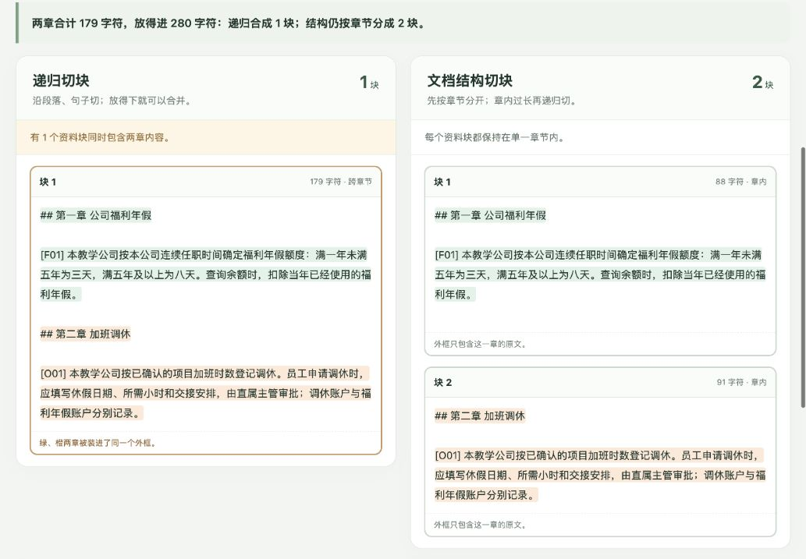

# RAG 切块实验室

同一份员工手册，换一种切法，AI 找回的资料和答案会有什么变化？

这是一个可以在自己电脑上运行的 Python 实验室。你可以比较六种切块方式，查看每块对应的原文、实际检索排名、最终交给 AI 的材料，再让 DeepSeek 回答员工问题。先看资料，再解释答案为什么不同。

**不用 API Key 也能开始：**看真实切口、比较递归与文档结构、运行 BM25 关键词检索。使用向量检索、语义切块或 AI 回答时，再填写自己的 API Key。



## 下载与启动

需要 Python **3.11 或更高版本**，推荐使用已验证的 Python 3.12。应用只使用轻量 Python 依赖，不下载本地大模型，也不需要 Node.js。Node.js 仅用于运行界面行为测试。

先下载项目：

```bash
git clone https://github.com/Taralili591/splitter-lab.git
cd splitter-lab
```

也可以在仓库页面选择 **Code → Download ZIP**，解压后在项目目录打开终端。

### macOS / Linux

```bash
python3 -m venv .venv
source .venv/bin/activate
python -m pip install -r requirements.txt
python -m labs.hr_chunking_lab --open
```

### Windows PowerShell

```powershell
py -3 -m venv .venv
.\.venv\Scripts\python.exe -m pip install -r requirements.txt
.\.venv\Scripts\python.exe -m labs.hr_chunking_lab --open
```

这些命令直接使用虚拟环境中的 Python，不需要修改 PowerShell 执行策略。

### 已安装 uv

在项目目录直接运行，uv 会准备环境与依赖：

```bash
uv run python -m labs.hr_chunking_lab --open
```

浏览器地址是 **http://127.0.0.1:8768/**。终端需要保持运行，按 `Ctrl+C` 停止服务。如果端口被占用，在启动命令后加 `--port 8769`。应用只监听本机地址。

## 第一轮：不用密钥，先看清楚怎么切

1. 打开 **「递归 vs 结构」**，或访问 http://127.0.0.1:8768/#boundaries 。保持短章节样例、块长上限 280：递归把 179 字符的两章合成一块，文档结构按章节分成两块。
2. 绿色、橙色代表不同章节，外框代表资料块。点击块，可在原文中定位它覆盖的范围。
3. 切到长章节样例。观察两种方式即使块数相同，切口也可能不同；结构方式仍会在过长章节内继续细分。
4. 打开 **「切块预览」**，切换固定、递归、文档结构、父子四种方式。不同块用不同底色，金色表示真实重叠，父块有独立边框。
5. 在公共设置选择 **「BM25 关键词 · 离线」**，选一道员工问题，点击「检索资料」。先比较实际找回的资料，暂时不点击回答按钮。

「递归 vs 结构」页始终使用相同原文、相同块长、零重叠，只比较切口，不额外附加标题路径。完整检索实验中的结构方式还会把章节标题用于检索，这两个作用可以分别观察。

## 第二轮：连接模型，让 AI 参加开卷考试

页面右上角点击 **「连接与密钥」**，分别填写并保存：

| 服务 | 在实验室中的用途 | 默认模型配置 |
| --- | --- | --- |
| DeepSeek | 为块补充背景、根据检索材料回答问题 | `deepseek-flash` |
| 硅基流动 | 文本向量化、向量检索、语义切块 | `BAAI/bge-m3` |

模型名可以在页面修改，请使用自己账户支持的模型 ID。也可以把 [配置示例](labs/hr_chunking_lab/.env.example) 复制为同目录的 `.env`，再填写自己的密钥：

```dotenv
DEEPSEEK_API_KEY=填写你的DeepSeek密钥
DEEPSEEK_BASE_URL=https://api.deepseek.com
DEEPSEEK_MODEL=deepseek-flash

SILICONFLOW_API_KEY=填写你的硅基流动密钥
SILICONFLOW_BASE_URL=https://api.siliconflow.cn/v1
SILICONFLOW_EMBEDDING_MODEL=BAAI/bge-m3
```

密钥保存在你电脑上的 `labs/hr_chunking_lab/.env`，页面不会回显已保存的值，导出结果也不包含密钥。`.env` 和运行缓存已加入 Git 忽略规则，不要把自己的配置文件提交到仓库。

选择向量检索后，点击「检索资料」会调用硅基流动。检索结束后，**单独点击「让 DeepSeek 回答」**，才会调用回答模型。语义切块的构建需要 Embedding，上下文补充的首次构建需要 DeepSeek；选择 BM25 不会免去这两种构建所需的 API。连接测试也会发送真实请求，费用由对应服务商按你的账户计费。

## 六种方式可以观察什么

| 方式 | 怎样组织资料 | 找到后交给 AI 的内容 |
| --- | --- | --- |
| 固定长度加重叠 | 按字符窗口切，相邻块重复少量原文 | 命中的原文块 |
| 递归切块 | 优先按段落、换行、句子拆分，再控制长度 | 命中的原文块 |
| 文档结构切块 | 先按章节划定范围，过长章节再递归拆；索引附带标题路径 | 原文块与章节标题 |
| 语义切块 | 根据相邻句子的语义变化寻找切口 | 命中的原文块 |
| 上下文补充 | 对递归原块补充定位背景，再建立索引 | 生成背景与原文，二者分别标记 |
| 父子切块 | 用小块定位，再回填它所属的父块 | 较大的完整父块，按父块去重 |

每种切法有自己的参数，切换后分别保留。检索方式、Top K、材料预算是所有方案共用的设置。「六组对比」会显示各组本轮实际用过的切块参数及最终阅读材料。

## 一个容易看懂的实验

选 Q01：“小林满五年、当年已用两天，今天还剩几天公司福利年假？”

1. 保持 Top K 为 3，分别尝试递归块长 280 和 560，检查“满五年对应八天”是否进入最终材料。
2. 再保持块长 280，只增加 Top K，看看之前排在后面的必要条款是否被取回。
3. 资料就绪后生成回答，展开「对照教材检查」，核对答案和原文覆盖。

不要只记录“答对 / 答错”。同时查看关键条款有没有被取回、是否因为排名或预算未装入，以及 AI 实际阅读了多少字符。换题或更换 Embedding 后，结果可能不同；项目没有预设某种方法一定获胜。

## 理解结果时的几个要点

- **同样填 280，不代表最终给 AI 的材料一样多。**语义方式的 280 是长度尺度，当前实现允许最大块长为其两倍；父子方式命中小块后会展开父块；上下文补充还会增加背景文字。
- **Top K 和材料预算同时生效。**Top K 限制最多装入的资料份数，材料预算限制总字符数。预算有剩余，也可能因为已经达到 Top K 而不再取下一块。放不下的整块会跳过，程序不会临时截断制度条款。
- **长度单位是 Unicode 字符，不是 token。**标点、空格与换行也计数。材料预算包含资料标签、章节标题、背景与父块正文，不包含系统提示词和用户问题。
- **重叠不一定恰好等于设定值。**固定方式按窗口保留指定字符；递归等方式尽量保留完整句段，实际重叠可能更少或为零。
- **上下文补充首次建库较慢。**当前实现为未缓存的块逐个调用 DeepSeek。相同原文、切口和模型可复用本机缓存；更改参数后产生的新块通常需要重新生成背景。它的预处理成本应与后续提问耗时分开看。
- **参考条款覆盖不是自动准确率。**覆盖按实际原文区间保守计算；生成背景不算原文证据，命中条款编号也不等于拿到整条规定。答案每次显式生成，不使用预设回答。

## 数据、代码与测试

员工手册、人物和福利安排均为教学虚构。题库共 12 题，其中 2 题故意缺少计算条件，用来观察 AI 是否会追问或承认资料不足。标准答案只用于操作者检查，不用于切块、Embedding、补背景或回答提示词。

```text
labs/hr_chunking_lab/
  data/handbook.md          完整员工手册，可替换后重新构建
  data/quiz.json            内置问题及参考答案
  data/boundary_demo_*.md   递归与结构的短、长章节样例
  chunking.py              六种方式的切块算法
  boundary_demo.py         同条件的切口对照
  visualization.py         原文范围、重叠与父子关系
  providers.py             DeepSeek、硅基流动及向量缓存
  engine.py                建库、排序、预算与证据覆盖
  server.py                本机 HTTP 服务与异步任务
  web/index.html           浏览器界面
tests/                     不调用付费 API 的自动化检查
```

完整参数与实现说明见 [实验室说明](labs/hr_chunking_lab/README.md)。运行时会创建 `labs/hr_chunking_lab/runtime/`，保存缓存和导出记录；发布包不包含作者的密钥、实验记录或缓存。

安装依赖后，在项目根目录运行 Python 测试：

```bash
python -m unittest discover -s tests -v
```

如果已安装 Node.js，还可以运行界面参数行为测试：

```bash
node --test tests/hr_strategy_params_frontend.test.js
```

测试使用临时目录和假服务检查算法、协议与数据流，不会消耗你的模型 API。版本变更见 [CHANGELOG](CHANGELOG.md)。

项目采用 [MIT 许可证](LICENSE)，可以下载、修改和分享自己的实验。
